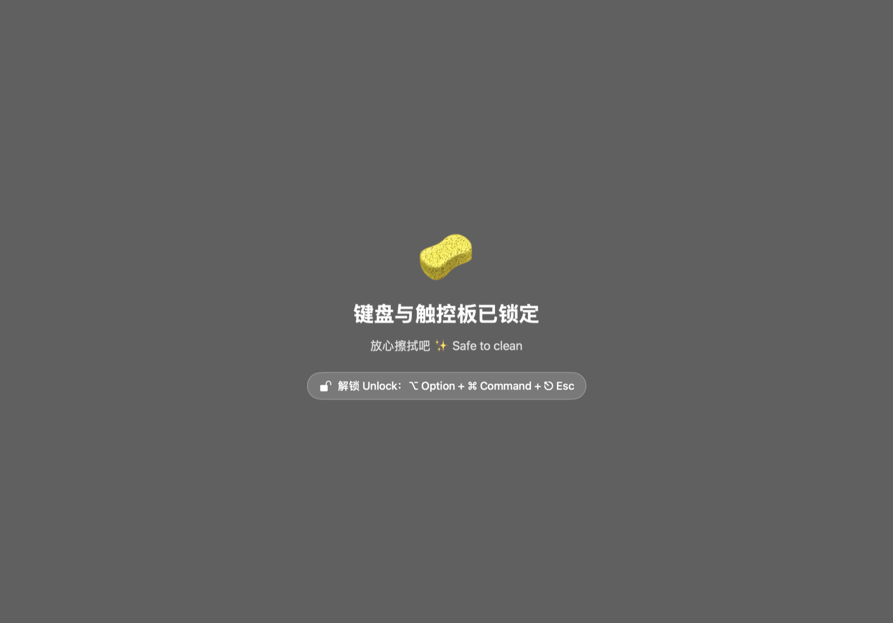

# 🧽 键盘清洁锁 KeyboardCleaner

[English](README.md) | **简体中文**

一个 macOS 菜单栏小工具：擦键盘/触控板时**锁住所有输入**，擦完按组合键（默认 `⌥ Option + ⌘ Command + ⎋ Esc`）即刻解锁。



## 解决什么问题

Mac 开着的时候擦键盘，总会误触：乱开应用、误删文件、把聊天消息发出去一半。键盘清洁锁在**系统层吞掉所有输入事件**——键盘、触控板、鼠标、滚轮、手势，连亮度/音量/媒体键都不放过——同时屏幕变暗给出提示。擦完按组合键，一切照旧。

## 功能特性

- 🔒 **全部拦截**：键盘、触控板、鼠标、滚轮、手势、亮度/音量/媒体键（会话级 `CGEventTap`，任何应用都收不到事件）
- 🔓 **组合键解锁**：按住 `⌥ ⌘` 再按 `⎋ Esc`——需要三键同时按下，擦拭时从键盘上划过绝不会误解锁，且完全可自定义
- 🖥 **每块屏幕都有变暗遮罩**，实时显示当前解锁组合键
- 🧯 **处处留后路**：
  - 遮罩自身永远不响应鼠标——即使拦截器意外失效，电脑也完全可用
  - 系统超时禁用拦截时会自动重新启用
  - 可选定时自动解锁（`--unlock-in`）兜底
  - 退出 app 必然解除锁定
  - 电源键是硬件行为，永远锁不住（正好当最后逃生舱）
- 🔏 **零遥测、零联网**——单文件约 500 行 Swift，无任何依赖，唯一申请的权限是「辅助功能」

## 快速上手

**环境要求**：macOS 13+，Xcode 命令行工具（`xcode-select --install`）。

```bash
git clone https://github.com/zhxnix/KeyboardCleaner.git
cd KeyboardCleaner
./build.sh          # 生成 ad-hoc 签名的 KeyboardCleaner.app
open KeyboardCleaner.app
```

1. 启动后右上角弹出提示气泡，菜单栏出现 🎹 图标（没有 Dock 图标、没有窗口，它住在菜单栏）
2. 点 **🔒 锁定键盘 Lock Keyboard**。首次使用 macOS 会要求**辅助功能**权限：系统设置 → 隐私与安全性 → 辅助功能 → 勾选「Keyboard Cleaner」，回来重新点一次锁定
3. 开始擦拭 🧽
4. 解锁：同时按下 `⌥ + ⌘ + Esc`

> 小技巧：第一次用不放心的话，可以 `open KeyboardCleaner.app --args --lock --unlock-in 60`，锁定 60 秒后自动解锁兜底。

## 自定义解锁组合键

用 `defaults` 持久化（改完重启 app 生效）：

```bash
defaults write local.zhao.keyboardcleaner unlockKey q
defaults write local.zhao.keyboardcleaner unlockMods "ctrl,shift"
```

- **按键**：`a-z` `0-9` `esc` `return` `space` `tab` `delete` `f1-f12`
- **修饰键**：`cmd` `alt` `ctrl` `shift` `fn` 任意组合（逗号分隔，建议至少一个，防止擦拭误触）

也可以启动时临时指定：`KeyboardCleaner --key q --mods ctrl,shift`

## 命令行

```
KeyboardCleaner                          正常启动（菜单栏）
KeyboardCleaner --lock                   启动即锁定
KeyboardCleaner --lock --unlock-in 300   锁定并 5 分钟后自动解锁
KeyboardCleaner --check                  自检：权限与拦截能力
KeyboardCleaner --help
KC_DEBUG=1 KeyboardCleaner ...           输出详细日志到 stderr
```

## 已知边界

- 密码框聚焦时系统开启「安全输入」，键盘事件无法被拦截——app 会检测到并提示先点别处，而不是假装已锁定
- 硬件行为（长按电源键、合盖）在任何事件拦截层之下——正好充当逃生舱
- 重新编译（`./build.sh`）后 ad-hoc 签名变化，系统可能要求重新授予辅助功能权限

## 实现原理

用 *default*（可拦截）模式创建会话级 `CGEventTap`，订阅键盘、鼠标、滚轮、手势、系统定义事件，然后对每个事件返回 `nil`——这些事件对系统其余部分而言就"不存在"了。解锁组合键在事件被丢弃前的回调里识别。整个核心就这么点东西，其余都是界面和安全兜底。详见 [KeyboardCleaner.swift](KeyboardCleaner.swift)。

## 许可证

[MIT](LICENSE) © 2026 zhxnix
